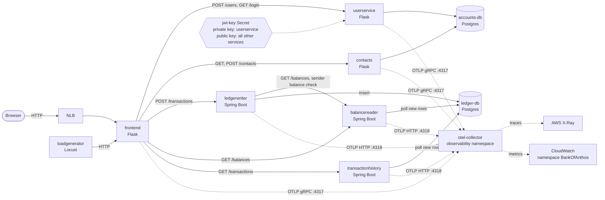
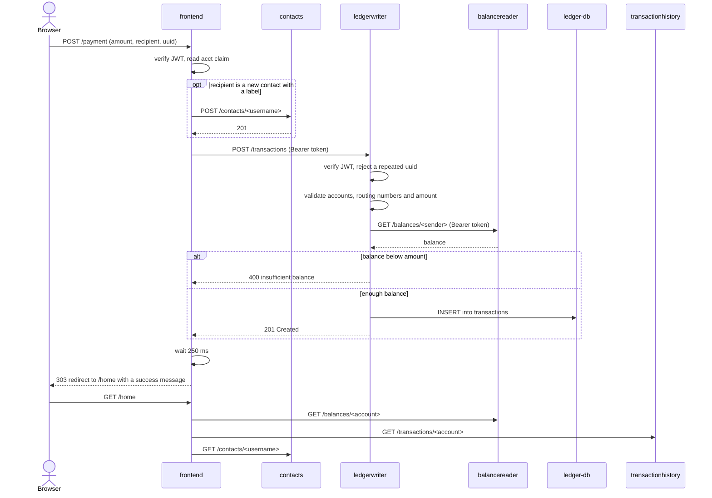

# Architecture overview

Bank of Anthos is a demo bank made of six services, two Postgres databases and a load generator. On EKS it runs in one namespace per environment (`boa` for production, `pr-<N>` for each pull request preview). This page explains what each piece does, how a payment travels through them, where data lives and how telemetry leaves the cluster. The Kubernetes manifests are in [`kubernetes-manifests/`](../kubernetes-manifests) and the EKS overlay is in [`deploy/eks/`](../deploy/eks).

## Diagram

Solid arrows are request or data paths, dotted arrows are telemetry and key distribution.

## Services

| Service | Path | Stack | Role |
|---|---|---|---|
| frontend | `src/frontend` | Python (Flask) | The only service users reach. Renders the pages, keeps the login token in a cookie, and calls every backend service. |
| userservice | `src/accounts/userservice` | Python (Flask) | Creates users (`POST /users`) and logs them in (`GET /login`). It is the only service that **signs** JWTs (RS256, with the private key). |
| contacts | `src/accounts/contacts` | Python (Flask) | Stores and returns each user's saved payee accounts (`/contacts/<username>`). |
| ledgerwriter | `src/ledger/ledgerwriter` | Java 17 (Spring Boot) | Validates and appends transactions to the ledger (`POST /transactions`). |
| balancereader | `src/ledger/balancereader` | Java 17 (Spring Boot) | Serves account balances (`GET /balances/<account>`) from a cache that it keeps current by polling the ledger. |
| transactionhistory | `src/ledger/transactionhistory` | Java 17 (Spring Boot) | Serves an account's recent transactions (`GET /transactions/<account>`), also cached from the ledger. |
| accounts-db | `src/accounts/accounts-db` | Postgres | Tables `users` and `contacts`. |
| ledger-db | `src/ledger/ledger-db` | Postgres | Table `transactions`. |
| loadgenerator | `src/loadgenerator` | Python (Locust) | Simulates users logging in, depositing and paying, through the frontend. |

Service addresses are injected from the `service-api-config` ConfigMap (`kubernetes-manifests/config.yaml`), for example `TRANSACTIONS_API_ADDR: ledgerwriter:8080`. Every service listens on port 8080 inside the cluster; only the frontend is exposed, through an internet-facing NLB restricted to an allow-list of CIDRs (`deploy/eks/frontend-lb.yaml`).

### Authentication

A login produces a JWT that carries the user name and the account id (`acct`). `userservice` signs it with the private key of the `jwt-key` Secret (generated per namespace by `deploy/eks/jwt-key.sh`, never committed). The frontend, `contacts`, `ledgerwriter`, `balancereader` and `transactionhistory` only hold the public key (mounted at `PUB_KEY_PATH`) and verify the token on each request. The frontend forwards the token as `Authorization: Bearer <token>` on every backend call.

## How a payment flows

A payment is a form post of `/payment` on the frontend (a deposit takes the same path through `/deposit`, with an external account as the sender, so the balance check is skipped).

1. **The frontend** checks that the token is valid, reads the account id from it, converts the amount to cents and builds the transaction (from and to account, routing number, amount and a request `uuid`). If the user typed a label for a new payee, it first saves that payee through `contacts`.
2. **ledgerwriter** verifies the token, drops a repeated `uuid` (a cache of recent requests makes a double submit harmless), and validates the transaction: the sender must be the account in the token, account numbers must be well formed, the sender cannot be the recipient, and the amount must be positive. For a sender in the local bank it then asks **balancereader** for the sender's balance, forwarding the token, and refuses the payment when the balance does not cover it.
3. If every check passes, ledgerwriter **inserts one row** into `transactions` in `ledger-db` and answers `201`. Any rejection is a `400` (or `401` for a bad token, `500` when the balance lookup fails); the frontend turns these into an error message on the page.
4. The frontend waits a quarter of a second, because balancereader and transactionhistory learn about the new row by polling the database, and then redirects to `/home`, which reads the balance, history and contacts in parallel.

## Where data lives

| Data | Owner | Stored in | Notes |
|---|---|---|---|
| Users (credentials hash, profile, account id) | userservice | `accounts-db`, table `users` | Seeded with demo users when `USE_DEMO_DATA` is `True`. |
| Contacts | contacts | `accounts-db`, table `contacts` | Foreign key to `users.username`. |
| Transactions | ledgerwriter (writes) | `ledger-db`, table `transactions` | Append-only: Postgres rules ignore `UPDATE` and `DELETE`. |
| Balances | balancereader | In-memory cache, rebuilt from `ledger-db` | Not stored anywhere: a balance is the sum of an account's ledger rows. |
| Recent history | transactionhistory | In-memory cache, filled from `ledger-db` | Size set by `HISTORY_LIMIT` and `CACHE_SIZE`. |
| Used request uuids | ledgerwriter | In-memory cache | Per pod; protects against duplicate submissions. |
| JWT key pair | userservice and verifiers | Kubernetes Secret `jwt-key` | One per namespace. |

Each database is owned by one side: only `userservice` and `contacts` talk to `accounts-db`, and only the three ledger services talk to `ledger-db`. The ledger services never read the accounts tables.

balancereader and transactionhistory each run a reader loop that polls `ledger-db` every `POLL_MS` milliseconds (default 100) for rows newer than the last one they saw, and update their caches from those rows.

Both Postgres StatefulSets use `emptyDir` volumes in the base manifests, so data lasts as long as the pod and is re-seeded from the demo data in `initdb` when the pod is recreated.

## How telemetry flows

All services export OpenTelemetry over OTLP; the GCP exporters are gone.

1. Each service reads `OTEL_EXPORTER_OTLP_ENDPOINT`, `OTEL_SERVICE_NAME` and `OTEL_RESOURCE_ATTRIBUTES` from its manifest. The Python services (frontend, userservice, contacts) send to `http://otel-collector.observability.svc.cluster.local:4317` (gRPC); the Java services (ledgerwriter, balancereader, transactionhistory) send to the same host on `:4318` (HTTP).
2. `OTEL_RESOURCE_ATTRIBUTES` includes `k8s.namespace.name`, taken from the downward API, so a trace from `pr-12` can be told apart from production's.
3. Services propagate W3C trace context (`traceparent`) on every call, so one user action is one trace: for example a payment is `frontend`, then `ledgerwriter`, then `balancereader`, followed by `balancereader`, `transactionhistory` and `contacts` when the home page reloads.
4. Every environment has an OpenTelemetry collector (`otel-collector` in the `observability` namespace). It sends **traces to AWS X-Ray** and **metrics to CloudWatch** under the namespace `BankOfAnthos`. The Java services' metrics are enabled with `ENABLE_METRICS`, and tracing with `ENABLE_TRACING`.
5. Every service's logs carry `trace_id` and `span_id`, which links a log line to its trace.

To check the pipeline end to end, follow "Checking telemetry" in [`deploy/eks/README.md`](../deploy/eks/README.md). For an alarm built on these metrics, see the [balance reads runbook](runbooks/balance-reads-slow.md).
